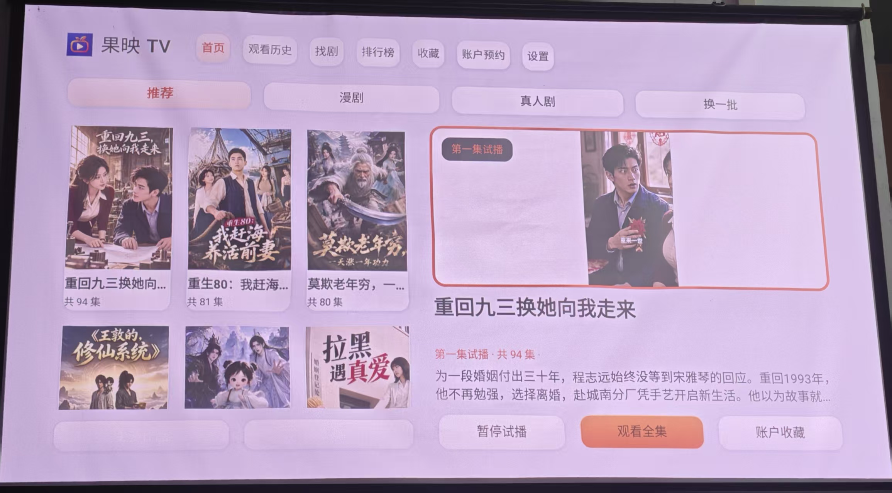
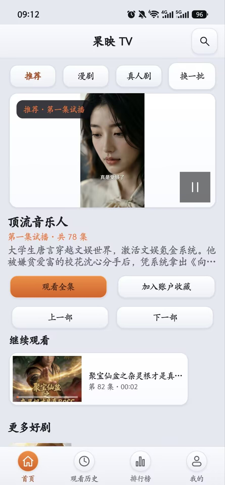
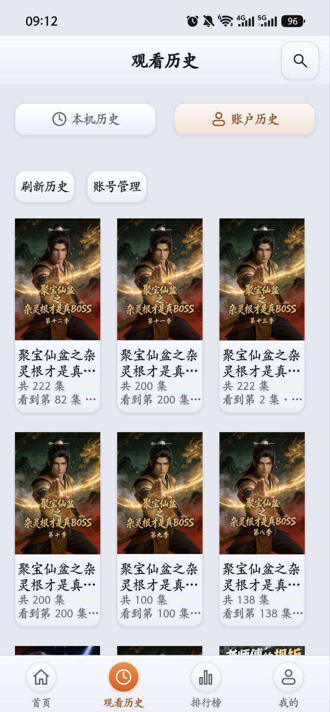
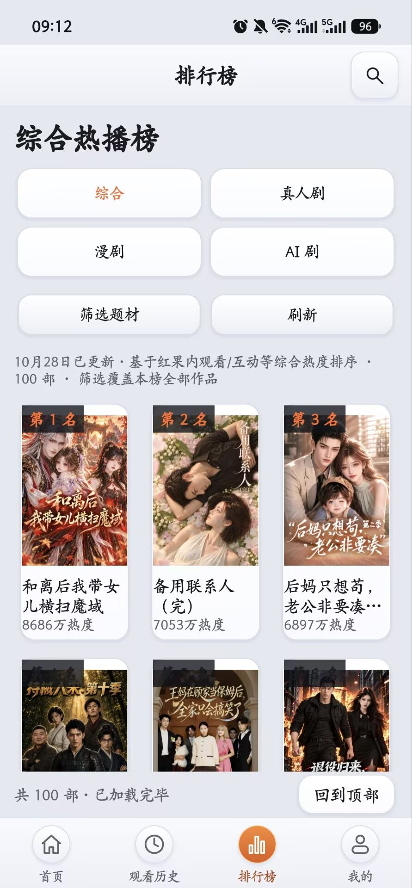

# 果映 TV · hongguoTV

本项目 Fork 自 [tsukiyo-zero/hongguoTV](https://github.com/tsukiyo-zero/hongguoTV)，感谢原作者及贡献者的开发与分享。

果映 TV 是一款非官方红果短剧客户端，支持 **Android 手机、平板和 TV**。同一个 APK 会根据设备和屏幕尺寸提供适合触屏或遥控器的界面，支持 Android 6.0 及以上。

从 [GitHub Releases](https://github.com/iFoxox/hongguoTV/releases) 下载正式安装包。此 fork 使用独立签名，不能覆盖安装原项目或调试签名版本；首次切换可能需要卸载旧版，本机数据和登录状态不会自动迁移。

## 手机端功能

- 通过底部导航浏览首页、观看历史、排行榜和个人中心，支持触屏搜索、分类筛选和剧集发现。
- 首页支持推荐、漫剧和真人剧首集试播；观看历史可在本机与账户记录之间切换。
- 首页分类与换批、历史来源、排行榜四个分类直接放在顶部栏，替代重复标题；右侧搜索找剧按钮与分类共用扁平样式，全部按钮无需横向滑动即可操作。大字号时标签在格内换行。
- 播放页支持选集、收藏、评论、弹幕和设置，并提供竖屏全屏与横屏全屏。
- 支持相关作品及前后季浏览，能够识别季数时默认定位到上一季附近。
- 支持官方网页登录或使用另一台设备扫码登录；账号功能及接口可用性取决于官方服务。

## 界面预览

### TV 首页

### 手机端

以下为此前版本截图；当前首页、历史和排行榜已将分类／来源按钮移入顶部栏，实际效果待手机安装验收。

<table>
  <tr><th>首页</th><th>观看历史</th><th>排行榜</th></tr>
  <tr>
    <td></td>
    <td></td>
    <td></td>
  </tr>
</table>

## 功能说明

### 找剧与发现

- 首页提供推荐、漫剧和真人剧首集试播，支持换剧、换一批、观看全集和收藏。
- 支持关键词搜索、分类与题材筛选，以及综合、真人剧、漫剧和 AI 剧热播榜。
- 剧集详情可查看简介、选集和相关作品；季数可识别时，相关作品默认定位到上一季附近。
- 手机使用触屏布局和底部导航；TV 使用顶部导航和遥控器操作。可在设置中切换界面模式及浅色、深色外观。
- 扫码输入、备份恢复、账号及设置等提示弹窗使用不透明的主题底板，说明文字与操作按钮随浅／深色外观配色；排行榜名次使用深底高对比度文字。

### 追剧与账号

- 支持本机收藏、观看历史、断点续播和已看标记，也可检查收藏作品的新增集数。
- 手机支持官方网页登录和扫码登录，TV 支持扫码登录；登录后可查看账户收藏、观看历史和预约。
- 本机记录与账户记录分开保存。退出或切换账号不会删除本机历史；账号同步能力取决于官方服务。

### 播放

- 支持选集、清晰度、倍速、画面模式、自动连播和定时停止；手机提供竖屏和横屏全屏。
- 播放失败时支持重试和切换清晰度，TV 可根据设备解码能力自动调整画质。
- TV 可使用遥控器控制播放、选集和快进快退。

### 评论与弹幕

- 详情页和播放页可查看本集评论，以及跟随视频时间的弹幕；弹幕支持调整字号、速度和密度。
- 评论和弹幕仅支持查看；首页首集试播暂不提供评论和弹幕。整剧评论为官网公开节选。

## 自动构建

推送代码后，GitHub Actions 会检查 Android 客户端并构建调试 APK。可在仓库的 Actions 中打开对应运行记录，从 Artifacts 下载 `guoying-android-debug` 产物。该 APK 使用调试签名，与正式版签名不同，不能用于覆盖安装正式版；构建产物不是正式 Release。

## 许可证

本项目与红果官方无关联，非官方接口可能随平台变化失效。项目以 [GPL-3.0](LICENSE) 发布；版权及第三方许可证声明予以保留，见 [原生第三方声明](kotlin-tv/NOTICE.md) 和 [旧服务第三方声明](server/vendor/NOTICE.md)。
